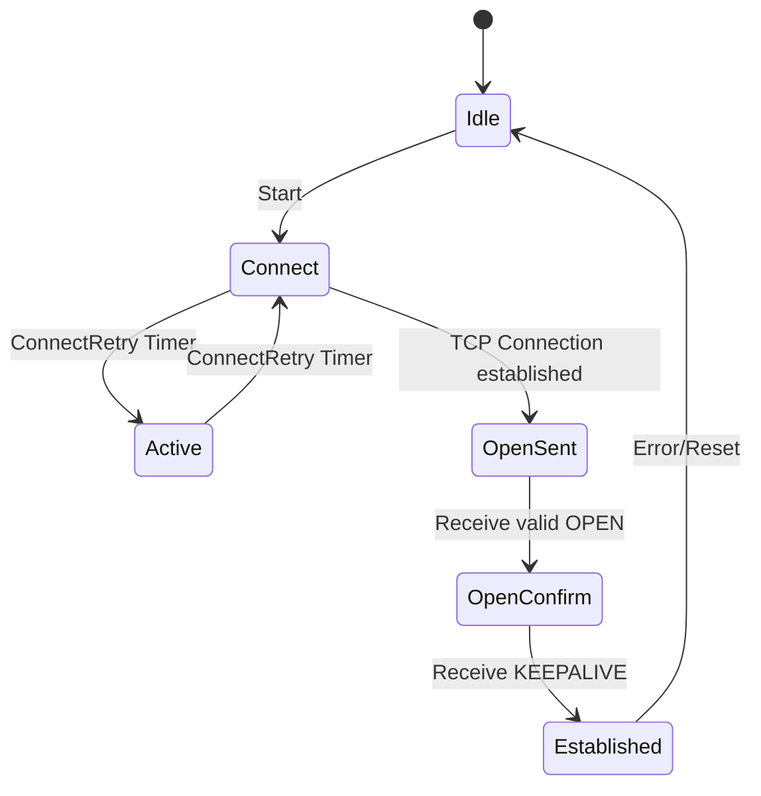

# Network Protocols Reference

Protocol-level reference for network-heavy rounds (Network Production Engineer, SRE networking). For the interview-shaped core, start with [networking-core.md](networking-core.md).

> Merged from 2024–2025 Meta Production Engineer prep notes. Overlapping copies were deduplicated; the newer, denser notes in this folder take precedence where they disagree.

# Models and core protocols

## Network Architecture Models

### OSI Model
The OSI (Open Systems Interconnection) model is a conceptual framework that standardizes network functions into 7 distinct layers. Think of it like a building:

#### Layer 7: Application
- The tenant interface - what users directly interact with (HTTP, FTP, SMTP)
- Provides network services directly to applications
- Examples: Email clients, web browsers
- Focus: User interaction and data formatting

#### Layer 6: Presentation 
- The interior decorator - handles data formatting and encryption
- Translates data between application and network formats
- Handles encryption/decryption, compression
- Key protocols: SSL/TLS, JPEG, ASCII

#### Layer 5: Session
- The building manager - manages conversations between applications
- Establishes, maintains, and terminates connections
- Handles authentication and authorization
- Examples: NetBIOS, RPC
- RPC works by allowing one program (a client) to directly call procedures (functions) on another machine (the server). The client makes a procedure call that appears to be local but is run on a remote machine.

#### Layer 4: Transport
- The elevator system - moves data between floors reliably
- Handles end-to-end communication
- Key protocols: TCP (reliable) and UDP (fast but unreliable)
- Flow control and error checking

#### Layer 3: Network
- The building's navigation system - handles routing between networks
- IP addresses live here
- Routers operate at this layer
- Handles packet routing and forwarding

#### Layer 2: Data Link
- The building's internal mail system - handles direct neighbor communication
- MAC addresses live here
- Switches operate at this layer
- Error detection and frame synchronization

#### Layer 1: Physical
- The building's foundation and utilities - raw bits over physical medium
- Cables, radio frequencies, voltage levels
- Network cards operate at this layer
- Handles raw bit transmission

### TCP/IP Model
A more practical, simplified model that maps closely to real-world implementation:

1. Application Layer (Combines OSI 5-7)
   - Protocols: HTTP, FTP, SMTP, DNS
   - Direct user services

2. Transport Layer (OSI 4)
   - TCP: Reliable, connection-oriented
   - UDP: Fast, connectionless
   - Port numbers

3. Internet Layer (OSI 3)
   - IP addressing and routing
   - ICMP for error reporting

4. Network Access Layer (OSI 1-2)
   - Physical transmission
   - MAC addressing

## Key Protocols and Services

### DNS (Domain Name System)
Think of DNS as the internet's phone book:

#### Components:
1. **DNS Resolver (Recursive Resolver)**
   - Initial contact point for DNS queries
   - Caches results for faster responses
   - Handles recursive resolution

2. **Root DNS Servers**
   - Top of DNS hierarchy
   - 13 logical root server clusters worldwide
   - Directs to TLD servers

1. **TLD (Top Level Domain) Servers**
   - Manage domains like .com, .org, .net
   - Direct to authoritative servers

2. **Authoritative DNS Servers**
   - Hold actual DNS records
   - Final authority for specific domains

#### Resolution Process:
1. Client queries resolver
2. Resolver queries root server
3. Root refers to TLD server
4. TLD refers to authoritative server
5. Authoritative server provides answer (or in case an alias came the recursive step repeats)

#### Record Types:
- A: IPv4 address
- AAAA: IPv6 address
- CNAME: Alias
- MX: Mail server
- NS: Nameserver
- TXT: Text records
- PTR: Reverse lookup

### HTTP (HyperText Transfer Protocol)

#### Key Concepts:
1. **Methods**
   - GET: Retrieve data
   - POST: Submit data
   - PUT: Update resource
   - DELETE: Remove resource
   - HEAD: Get headers only
   - OPTIONS: Get supported methods

2. **Status Codes**
   - 1xx: Informational
   - 2xx: Success
   - 3xx: Redirection
   - 4xx: Client Error
   - 5xx: Server Error

3. **Headers**
   - Content-Type
   - Authorization
   - Cookie
   - Cache-Control
   - User-Agent

#### HTTPS
- Adds SSL/TLS encryption
- Certificate-based authentication
- Secure key exchange
- Data integrity

### ARP (Address Resolution Protocol)
Maps IP addresses to MAC addresses:

1. **Process**
   - Device needs MAC for IP
   - Broadcasts ARP request
   - Target responds with MAC
   - Result cached in ARP table

2. **Security Considerations**
   - ARP spoofing
   - MAC flooding
   - Mitigation strategies

### DHCP (Dynamic Host Configuration Protocol)
Automates IP address assignment:

#### Process (DORA):
1. **Discovery**
   - Client broadcasts request
2. **Offer**
   - Server offers IP
3. **Request**
   - Client accepts offer
4. **Acknowledgment**
   - Server confirms assignment

#### Configuration Options:
- IP address
- Subnet mask
- Default gateway
- DNS servers
- Lease duration

### BGP (Border Gateway Protocol)
Internet's routing protocol:

#### Key Concepts:
1. **AS (Autonomous Systems)**
   - Independent network regions
   - Unique AS numbers

2. **Path Attributes**
   - AS_PATH
   - NEXT_HOP
   - LOCAL_PREF

3. **Route Selection**
   - Path length
   - Policy rules
   - Business relationships

### OSPF (Open Shortest Path First)
Internal routing protocol:

#### Features:
1. **Area-based hierarchy**
   - Backbone (Area 0)
   - Standard areas
   - Stub areas

2. **Route calculation**
   - Dijkstra's algorithm
   - Link state updates
   - Cost metrics

### DMZ (Demilitarized Zone)
Security buffer zone:

#### Implementation:
1. **Architecture**
   - External firewall
   - Internal firewall
   - DMZ segment

2. **Common Services**
   - Web servers
   - Email servers
   - DNS servers

3. **Security Measures**
   - Access control lists
   - Network segmentation
   - Monitoring

# Handshakes in detail

#### TCP

##### TCP Threeway Handshake

The **TCP three-way handshake** is a process used by the Transmission Control Protocol (TCP) to establish a reliable connection between two devices (typically a client and a server) over a network. This handshake ensures that both devices are ready to communicate and agree on initial sequence numbers for data transmission. The process involves three steps, hence the name "three-way handshake."

**Steps in the TCP Three-Way Handshake:**
1. **SYN (Synchronize) Packet**:
   - The client initiates the connection by sending a TCP segment with the **SYN** flag set to 1.
   - This packet includes an initial sequence number (ISN) chosen by the client, which will be used to track the order of data packets.
   - The client enters the **SYN-SENT** state.

2. **SYN-ACK (Synchronize-Acknowledge) Packet**:
   - The server responds to the client's SYN packet by sending a TCP segment with both the **SYN** and **ACK** flags set to 1.
   - The server acknowledges the client's sequence number by incrementing it by 1 (ACK = ISN + 1) and includes its own initial sequence number.
   - The server enters the **SYN-RECEIVED** state.

3. **ACK (Acknowledge) Packet**:
   - The client sends a final TCP segment with the **ACK** flag set to 1.
   - This packet acknowledges the server's sequence number by incrementing it by 1 (ACK = server's ISN + 1).
   - At this point, the connection is established, and both the client and server enter the **ESTABLISHED** state.

```
Client                            Server
  |                                |
  | -------- SYN (ISN=X) --------> |
  | <------ SYN-ACK (ISN=Y, ACK=X+1) |
  | -------- ACK (ACK=Y+1) -------> |
  |                                |
```

**Connection Termination:**
To terminate a TCP connection, a similar process called the **four-way handshake** is used, involving FIN (Finish) and ACK packets.

#### TLS/SSL
##### Handshake

The TLS/SSL handshake is a process that occurs when a client (e.g., a web browser) connects to a server over HTTPS (HTTP Secure). This handshake establishes a secure, encrypted connection between the client and the server. 
1. **Client Hello**
   - The client initiates the handshake by sending a "Client Hello" message to the server.
   - This message includes:
     - The TLS/SSL version supported by the client.
     - A list of cipher suites (encryption algorithms) the client supports.
     - A randomly generated number (Client Random) that will be used later in the key generation process.
2. **Server Hello**
   - The server responds with a "Server Hello" message.
   - This message includes:
     - The TLS/SSL version selected by the server (usually the highest version supported by both client and server).
     - The cipher suite selected by the server from the list provided by the client.
     - A randomly generated number (Server Random) that will also be used in key generation.
     - The server's SSL/TLS certificate, which contains the server's public key and is signed by a trusted Certificate Authority (CA).
3. **Server Certificate Verification**
   - The client verifies the server's certificate to ensure it is valid and trusted.
   - The client checks:
     - The certificate's expiration date.
     - Whether the certificate is signed by a trusted CA.
     - Whether the certificate matches the server's domain name.
4. **Key Exchange**
   - The client and server exchange cryptographic information to establish a shared secret key for symmetric encryption.
   - The exact method depends on the cipher suite selected:
     - **RSA Key Exchange**: The client generates a pre-master secret, encrypts it with the server's public key (from the certificate), and sends it to the server. The server decrypts it using its private key.
     - **Diffie-Hellman (DH) Key Exchange**: The client and server exchange public values and use them to compute the same shared secret without transmitting the secret directly.
5. **Session Keys Generation**
   - Both the client and server use the Client Random, Server Random, and pre-master secret to generate the same symmetric session keys.
   - These session keys will be used for encrypting and decrypting data during the session.
6. **Client and Server Ready**
   - The client sends a "Finished" message to the server, encrypted with the session key, to confirm that the handshake is complete.
   - The server sends its own "Finished" message, also encrypted with the session key, to confirm the handshake.
7. **Secure Communication Begins**
   - Once the handshake is complete, the client and server use the symmetric session keys to encrypt and decrypt all data exchanged during the session.
   - This ensures that the communication is secure and protected from eavesdropping or tampering.

#### ICMP

**ICMP (Internet Control Message Protocol)** is a network layer protocol used for **error reporting** and **diagnostic purposes** in IP networks. It is an essential part of the Internet Protocol (IP) suite and works alongside IP to provide feedback about network conditions. Here's a detailed explanation:

- **Error Reporting**: ICMP sends error messages when network issues occur, such as unreachable hosts, timeouts, or routing problems.
- **Diagnostics**: ICMP is used for network troubleshooting tools like **ping** and **traceroute**.
- **Network Management**: It helps devices communicate about network conditions and manage traffic efficiently.

**How does it work?**
- ICMP messages are encapsulated within IP packets (protocol number **1**) and sent between devices.
- ICMP does not establish a connection or transmit data; it only provides feedback about the network.
- ICMP messages are typically generated by network devices like routers or hosts.

**Error Messages**
- **Destination Unreachable (Type 3)**: Sent when a packet cannot reach its destination. Subtypes include:
    - Network unreachable
    - Host unreachable
    - Port unreachable
    - Protocol unreachable
    
- **Time Exceeded (Type 11)**: Sent when a packet's TTL (Time to Live) expires, indicating a routing loop or too many hops.
- **Source Quench (Type 4)**: Requests the sender to reduce the rate of packet transmission (rarely used today).
- **Redirect (Type 5)**: Informs the sender of a better route to the destination.

**Query Messages**

- **Echo Request (Type 8) and Echo Reply (Type 0)**: Used by the **ping** command to check if a host is reachable.
- **Timestamp Request (Type 13) and Timestamp Reply (Type 14)**: Used to synchronize clocks between devices.
- **Address Mask Request (Type 17) and Address Mask Reply (Type 18)**: Used to determine the subnet mask of a network.
**ICMP in Action**
- Ping:
	Sends an Echo Request to a target host.
	If the host is reachable, it responds with an Echo Reply.
	Measures round-trip time (RTT) and packet loss.
- Traceroute:
	Uses Time Exceeded and Destination Unreachable messages to map the path to a destination.
	Sends packets with increasing TTL values to identify each hop along the route.

# TCP/IP protocol suite — deep dive

### 1. Protocol Architecture

#### A. Network Access Layer (Layer 1 & 2)

##### Physical Layer Protocols
- **Ethernet (IEEE 802.3)**
  - Frame Structure:
    ```
    |Preamble|SFD|Dest MAC|Source MAC|Type|Payload|FCS|
    |  7B    |1B |   6B   |    6B    | 2B |42-1500| 4B|
    ```
  - Speed Standards:
    - 10BASE-T: 10 Mbps over Cat3/Cat5
    - 100BASE-TX: 100 Mbps over Cat5
    - 1000BASE-T: 1 Gbps over Cat5e/Cat6
    - 10GBASE-T: 10 Gbps over Cat6a/Cat7
  
- **Wi-Fi (IEEE 802.11)**
  - Frame Types:
    - Management Frames (Beacon, Probe, Authentication)
    - Control Frames (RTS, CTS, ACK)
    - Data Frames
  - Standards:
    ```
    802.11n: 2.4/5 GHz, up to 600 Mbps
    802.11ac: 5 GHz, up to 3.5 Gbps
    802.11ax (Wi-Fi 6): 2.4/5/6 GHz, up to 9.6 Gbps
    ```

#### B. Internet Layer (Layer 3)

##### IPv4
- **Address Structure**
  ```
  Class A: 0XXXXXXX.H.H.H    (1-126)
  Class B: 10XXXXXX.N.H.H    (128-191)
  Class C: 110XXXXX.N.N.H    (192-223)
  Class D: 1110XXXX (Multicast)
  Class E: 1111XXXX (Reserved)
  ```

- **Special Addresses**
  ```
  Network: All host bits = 0
  Broadcast: All host bits = 1
  Localhost: 127.0.0.1
  Private Ranges:
    10.0.0.0/8
    172.16.0.0/12
    192.168.0.0/16
  ```

- **Subnetting**
  ```
  CIDR Notation: /n where n = network bits
  Subnet Mask Examples:
    /24 = 255.255.255.0
    /16 = 255.255.0.0
    /8 = 255.0.0.0
  ```

##### IPv6
- **Address Structure**
  ```
  |         64 bits          |         64 bits          |
  | Network Prefix          | Interface ID            |
  ```

- **Address Types**
  ```
  Unicast: Single interface
    - Global: 2000::/3
    - Link-local: fe80::/10
  Multicast: ff00::/8
  Anycast: Assigned from unicast
  ```

#### C. Transport Layer (Layer 4)

##### TCP
- **Header Format**
  ```
  |Source Port|Dest Port|Sequence Number|Ack Number|
  |   16 bits | 16 bits|    32 bits    | 32 bits  |
  |Data Offset|Reserved|Flags|Window Size|
  |   4 bits  | 6 bits |6 bits| 16 bits |
  |Checksum   |Urgent Pointer|Options|Padding|
  | 16 bits   |   16 bits   |0-40 bytes|  |
  ```

- **Connection States**
  ```
  CLOSED → LISTEN → SYN-RECEIVED → ESTABLISHED
  ESTABLISHED → FIN-WAIT-1 → FIN-WAIT-2 → TIME-WAIT → CLOSED
  ```

- **Flow Control**
  - Window Size: Advertised by receiver
  - Sliding Window Protocol:
    ```
    |← Sent & Acknowledged →|← Sent, Not Acked →|← Can Send →|
    |      (left edge)      |    (in flight)    | (window)   |
    ```

##### UDP
- **Header Format**
  ```
  |Source Port|Dest Port|Length|Checksum|
  | 16 bits   | 16 bits|16 bits|16 bits|
  ```

#### D. Application Layer (Layer 7)

##### HTTP/1.1
- **Request Format**
  ```
  METHOD /path HTTP/1.1
  Host: example.com
  [Other Headers]
  
  [Body if POST/PUT]
  ```

- **Response Format**
  ```
  HTTP/1.1 STATUS_CODE REASON
  Content-Type: type/subtype
  Content-Length: length
  [Other Headers]
  
  [Response Body]
  ```

##### DNS
- **Resource Records**
  ```
  NAME        TTL  CLASS  TYPE  RDATA
  example.com 3600 IN     A     93.184.216.34
  example.com 3600 IN     MX    10 mail.example.com
  example.com 3600 IN     CNAME www.example.com
  ```

- **Query Types**
  ```
  Recursive: Resolver does all work
  Iterative: Client follows referrals
  ```

### 2. Protocol Operations

#### A. TCP Connection Establishment
```
1. Client → Server: SYN (SEQ=x)
2. Server → Client: SYN+ACK (SEQ=y, ACK=x+1)
3. Client → Server: ACK (SEQ=x+1, ACK=y+1)
```

#### B. TCP Data Transfer
```
Sender                        Receiver
  | ← Window Size = 4096        |
  | SEQ=100, Len=1000 →        |
  | SEQ=1100, Len=1000 →       |
  |                   ACK=2100 ← |
  | SEQ=2100, Len=1000 →       |
```

#### C. TCP Connection Termination
```
1. Client → Server: FIN
2. Server → Client: ACK
3. Server → Client: FIN
4. Client → Server: ACK
[TIME-WAIT]
```

### 3. Protocol Tools & Diagnostics

#### A. Network Analysis Tools
```bash
# Packet Capture
tcpdump -i eth0 'tcp port 80'
tcpdump -i any -n 'host 192.168.1.1'

# Connection Status
netstat -tuln
ss -tuln

# Interface Statistics
ifconfig
ip -s link show
```

#### B. Protocol Analysis
```bash
# DNS Lookup
dig example.com
dig @8.8.8.8 example.com ANY

# HTTP Testing
curl -v http://example.com
wget --server-response http://example.com

# TCP Connection Testing
nc -vz example.com 80
telnet example.com 80
```

#### C. ICMP Operations
```bash
# Basic Ping
ping -c 4 example.com

# MTU Discovery
ping -M do -s 1472 example.com

# Traceroute
traceroute -I example.com
mtr example.com
```

### 4. Common Issues & Troubleshooting

#### A. Connectivity Issues
1. Physical Layer
   ```bash
   # Check Interface Status
   ethtool eth0
   ip link show
   ```

2. Network Layer
   ```bash
   # Check IP Configuration
   ip addr show
   ip route show
   ```

3. Transport Layer
   ```bash
   # Check Port Status
   netstat -tuln | grep :80
   lsof -i :80
   ```

#### B. Performance Issues
1. Network Performance
   ```bash
   # Bandwidth Testing
   iperf3 -c server
   
   # Latency Testing
   ping -f -c 1000 target
   ```

2. Protocol Performance
   ```bash
   # TCP Window Size
   ss -ti
   
   # Interface Errors
   ip -s link show eth0
   ```

This deep dive into TCP/IP covers the fundamental protocols, their operations, and troubleshooting techniques. Each section includes practical examples and command references that are commonly used in network engineering.

# BGP — implementation guide

### 1. BGP Protocol Fundamentals

#### A. Message Types & Formats

##### BGP Message Header
```
0                   1                   2                   3
0 1 2 3 4 5 6 7 8 9 0 1 2 3 4 5 6 7 8 9 0 1 2 3 4 5 6 7 8 9 0 1
+-+-+-+-+-+-+-+-+-+-+-+-+-+-+-+-+-+-+-+-+-+-+-+-+-+-+-+-+-+-+-+-+
|                                                               |
+                                                               +
|                                                               |
+                     Marker (16 octets)                        +
|                                                               |
+                                                               +
|                                                               |
+-+-+-+-+-+-+-+-+-+-+-+-+-+-+-+-+-+-+-+-+-+-+-+-+-+-+-+-+-+-+-+-+
|          Length               |      Type     |
+-+-+-+-+-+-+-+-+-+-+-+-+-+-+-+-+-+-+-+-+-+-+-+
```

##### Message Types
1. **OPEN (Type 1)**
   ```
   - Version (1 byte)
   - AS Number (2 bytes)
   - Hold Time (2 bytes)
   - BGP Identifier (4 bytes)
   - Optional Parameters Length (1 byte)
   - Optional Parameters (variable)
   ```

2. **UPDATE (Type 2)**
   ```
   - Withdrawn Routes Length (2 bytes)
   - Withdrawn Routes (variable)
   - Total Path Attribute Length (2 bytes)
   - Path Attributes (variable)
   - Network Layer Reachability Info (variable)
   ```

3. **NOTIFICATION (Type 3)**
   ```
   - Error Code (1 byte)
   - Error Subcode (1 byte)
   - Data (variable)
   ```

4. **KEEPALIVE (Type 4)**
   - No payload, just header

#### B. Path Attributes

##### 1. Well-known Mandatory
```
ORIGIN:
  - Value: 1
  - Type Code: 1
  - Values: IGP (0), EGP (1), INCOMPLETE (2)

AS_PATH:
  - Value: 2
  - Segments: AS_SET {}, AS_SEQUENCE

NEXT_HOP:
  - Value: 3
  - Contains next hop IP address
```

##### 2. Well-known Discretionary
```
LOCAL_PREF:
  - Value: 5
  - Default: 100
  - Higher values preferred

ATOMIC_AGGREGATE:
  - Value: 6
  - No value field
```

##### 3. Optional Transitive
```
AGGREGATOR:
  - Value: 7
  - Contains AS number and router ID

COMMUNITY:
  - Value: 8
  - Format: AS:VALUE
  - Well-known: NO_EXPORT (65535:65281)
                NO_ADVERTISE (65535:65282)
```

##### 4. Optional Non-transitive
```
MED (MULTI_EXIT_DISC):
  - Value: 4
  - Lower values preferred
```

### 2. BGP Operations

#### A. BGP States


#### B. BGP Route Selection Process
```
1. Highest Weight (Cisco-specific)
2. Highest LOCAL_PREF
3. Locally originated routes
4. Shortest AS_PATH length
5. Lowest origin type (IGP < EGP < INCOMPLETE)
6. Lowest MED
7. eBGP over iBGP paths
8. Lowest IGP metric to next hop
9. Oldest path
10. Lowest Router ID
```

### 3. BGP Configuration Examples

#### A. Basic BGP Configuration (Cisco IOS)
```cisco
router bgp 65000
 neighbor 192.168.1.1 remote-as 65001
 neighbor 192.168.1.1 description Peer1
 network 10.0.0.0 mask 255.255.0.0
 bgp router-id 1.1.1.1
```

#### B. Route Filtering
```cisco
! Using Prefix Lists
ip prefix-list FILTER-IN seq 10 permit 192.168.0.0/16 le 24
!
router bgp 65000
 neighbor 192.168.1.1 prefix-list FILTER-IN in

! Using AS Path Access Lists
ip as-path access-list 10 permit ^65001$
!
router bgp 65000
 neighbor 192.168.1.1 filter-list 10 in
```

#### C. Route Maps
```cisco
route-map SET-LOCAL-PREF permit 10
 match ip address prefix-list CUSTOMER-ROUTES
 set local-preference 200
!
router bgp 65000
 neighbor 192.168.1.1 route-map SET-LOCAL-PREF in
```

### 4. BGP Security

#### A. RPKI Configuration
```cisco
! Enable RPKI
router bgp 65000
 bgp rpki server tcp 192.168.1.100 port 3323
 bgp rpki server tcp 192.168.1.101 port 3323

! Define RPKI Policies
route-map RPKI permit 10
 match rpki valid
 set local-preference 200
!
route-map RPKI permit 20
 match rpki not-found
 set local-preference 100
!
route-map RPKI deny 30
 match rpki invalid
```

#### B. Authentication
```cisco
! MD5 Authentication
router bgp 65000
 neighbor 192.168.1.1 password MySecretKey

! IPSec Configuration
crypto isakmp policy 10
 encryption aes 256
 authentication pre-share
 group 5
!
crypto ipsec transform-set BGP-TRANSFORM esp-aes 256 esp-sha-hmac
```

### 5. BGP Troubleshooting

#### A. Common Commands
```cisco
! Check BGP Summary
show ip bgp summary

! Verify BGP Neighbors
show ip bgp neighbors

! Check Specific Prefix
show ip bgp 192.168.0.0/24

! View BGP Route Selection
show ip bgp 192.168.0.0/24 bestpath

! Debug BGP Updates
debug ip bgp updates

! Check RPKI Status
show ip bgp rpki servers
show ip bgp rpki table
```

#### B. Common Issues & Solutions

1. **Neighbor Not Establishing**
   ```
   - Verify TCP connectivity (telnet to port 179)
   - Check AS numbers match configuration
   - Verify MD5 passwords match
   - Check for ACLs blocking BGP
   ```

2. **Routes Not Being Advertised**
   ```
   - Verify network statements
   - Check route redistribution
   - Verify prefix-lists and filters
   - Check route-maps
   ```

3. **Route Selection Issues**
   ```
   - Compare path attributes
   - Check MED configuration
   - Verify LOCAL_PREF settings
   - Check IGP metrics for recursive lookups
   ```

### 6. BGP Best Practices

#### A. Design Considerations
```
1. Use Private AS Numbers for Internal Networks
   - Range: 64512-65534 (16-bit)
   - Range: 4200000000-4294967294 (32-bit)

2. Implement Route Summarization
   - Reduce routing table size
   - Improve stability
   - Use aggregate-address command

3. Implement Route Filters
   - Inbound prefixes
   - AS path filtering
   - Community filtering
```

#### B. Scaling Considerations
```
1. Route Reflectors
   router bgp 65000
    neighbor 192.168.1.1 route-reflector-client

2. Confederation
   router bgp 65000
    bgp confederation identifier 100
    bgp confederation peers 65001 65002

3. Peer Groups
   router bgp 65000
    neighbor INTERNAL peer-group
    neighbor INTERNAL remote-as 65000
    neighbor 192.168.1.1 peer-group INTERNAL
```

This technical guide provides a comprehensive overview of BGP implementation, including protocol details, configuration examples, security considerations, and troubleshooting procedures. The examples use Cisco IOS syntax but the concepts apply to all vendors.

# Linux network stack internals

## Network Stack Implementation

### 1. TCP/IP Stack Architecture

#### Layer Overview
```
Application Layer (L7)
    ↓
Socket Layer
    ↓
TCP/UDP Layer (L4)
    ↓
IP Layer (L3)
    ↓
Network Device Layer (L2)
    ↓
Physical Layer (L1)
```

#### Key Components

##### Socket Layer
- Provides BSD socket interface
- Manages connection state
- Handles buffering and flow control

Socket States:
```
CLOSED → LISTEN → SYN_RCVD → ESTABLISHED
                          ↑
                    SYN_SENT (client)
```

Debugging Tools:
```bash
# View socket statistics
$ ss -netuap
# Monitor socket states
$ netstat -nat
# Track socket operations
$ strace -e trace=network ./program
```

##### TCP Implementation

Key Features:
- Sliding window flow control
- Congestion control algorithms
- Connection management
- Retransmission handling

Congestion Control Algorithms:
4. CUBIC (Default in Linux)
5. BBR (Better for high bandwidth-delay)
6. Vegas (Delay-based)

Debugging:
```bash
# Check TCP parameters
$ sysctl -a | grep net.ipv4.tcp
# Monitor TCP metrics
$ ss -ti
# Analyze TCP retransmissions
$ netstat -s | grep retransmit
```

Common Interview Questions:

7. "Explain TCP congestion control and its impact at scale"
Strong Answer: "TCP congestion control involves:
- Slow start phase for new connections
- Congestion avoidance using window scaling
- Fast retransmit/recovery for packet loss
- Algorithm choice matters: loss-based (CUBIC, the Linux default) vs model-based (BBR, better on high bandwidth-delay paths)
- At scale: tune per workload, and pool connections to avoid repeated slow start"

8. "How would you debug high network latency?"
Strong Answer: "I would:
1. First check basic connectivity:
   ```bash
   $ ping target_host
   $ traceroute target_host
   ```
2. Analyze TCP metrics:
   ```bash
   $ ss -ti | grep -i retrans
   $ netstat -s | grep -i retransmit
   ```
3. Monitor interface statistics:
   ```bash
   $ ifconfig -a
   $ ethtool -S eth0
   ```
4. Use advanced tools:
   ```bash
   $ tcpdump -i eth0 -n
   $ iptraf-ng
   ```
5. Check system resources:
   - CPU usage (network processing)
   - Memory (network buffers)
   - Interrupt handling"

## Receive / transmit path

### Receive Path
1. NIC receives packet
2. DMA to ring buffer
3. Interrupt handling
4. NAPI polling
5. Protocol stack processing
6. Socket buffer delivery

### Transmit Path
1. Application writes data
2. Protocol stack processing
3. QoS/Traffic shaping
4. Device queue selection
5. DMA to NIC
6. Hardware transmission

Performance Optimization:
- Interrupt coalescing
- Zero-copy operations
- TSO/LRO offloading
- RSS/RPS configurations

Debugging Tools:
```bash
# Check interface offload settings
$ ethtool -k eth0
# Monitor interrupt handling
$ cat /proc/interrupts
# Analyze network stack statistics
$ nstat -az
```

# Interview questions (with worked answers for the first few)

## Possible Interview Questions

### High-Level Questions:
1. "Explain how a user's request to view a webpage travels through the network layers."
	1. First, when the website domain/ URL is entered the DNS is used to resolve that actual IP of that domain. Here, multiple steps take place:
		1. If there is an entry in the `/etc/hosts` for that domain name, it gets retrieved first
		2. If not, the system checks for the cached DNS entries, if found, the system directly returns the IP.
		3. If not, the DNS recursive resolver takes the request and goes through the recursive IP retrieval, where firstly, a request gets sent to the root DNS server to then be forwarded to the Top Level Domain according to the domain of the url, then the TLD will forward a request to the authoritative DNS server where the actual IPs for the requests are gotten, if an alias was retrieved then the recursive resolver will repeat these steps
	2. Then, the TCP handshake will take place where both the server and client will communicate to start a connection
	3. Then, if the website has SSL, the SSL authentication steps will take place, where the server will share the public certificate then depending on the TLS encryption algorithm used an authentication handshake will take place between the client and the server
	4. After the website had SSL and we finished the authentication, or after we didn't have encryption at all, the HTTP GET or POST request gets sent with the content type specifying the expected returned/sent data.
	5. When the server receives the request, it handles the process and responds with the webpage. Also, if the GET request is cached, it gets directly retrieved.
	6. All of the requests sent throughout the process follow routing protocols like OSPF or BGB to gets sent. And from the client, a valid network connection will be needed (in case the website is not on the local host or in the same network).
2. "How would you design a scalable DNS infrastructure?"
3. "What happens when a new device joins a network?"
	When a new device joins a network, the following steps occur:
	
	1. Physical Layer Initialization:
	   - Network interface is powered up
	   - Device driver initializes the hardware
	   - Link status is detected
	
	2. Data Link Layer:
		   - MAC address is configured for the interface
	   - For wireless: Association/authentication with access point
	
	3. Network Layer Configuration (IPv4):
	   a. DHCP Process (if not static):
	      - DHCP DISCOVER (broadcast, source IP 0.0.0.0)
	      - DHCP OFFER (server proposes IP, subnet, gateway, DNS)
	      - DHCP REQUEST (client confirms selection)
	      - DHCP ACK (server confirms assignment)
	   
	   b. ARP Operations:
	      - Gratuitous ARP to detect IP conflicts
	      - ARP request for default gateway
	      - ARP cache population begins
	
	4. Additional Configuration:
	   - DNS servers configured (/etc/resolv.conf in Linux)
	   - Routing table updated with default gateway
	   - Network services start (NetworkManager updates connection state)
	   
	5. Network Verification:
	   - Interface brings up IPv4/IPv6 addresses
	   - Default gateway reachability test
	   - DNS resolution test
	
	Common issues and debugging:
	- IP conflicts (detected via gratuitous ARP)
	- DHCP server unavailability (ipconfig /release /renew)
	- Driver issues (dmesg, lspci)
1. "How would you troubleshoot a network connectivity issue?"
2. "Explain BGP's role in internet routing."

### Specific Technical Questions:
1. "What happens during TCP's three-way handshake?"
2. "How does ARP prevent duplicate IP addresses?"
3. "What's the difference between authoritative and recursive DNS servers?"
4. "Explain the process of DHCP lease renewal."
5. "How does BGP handle route flapping?"
6. "What security measures would you implement in a DMZ?"
7. "How does OSPF calculate the best path?"
8. "What happens when a DNS cache becomes poisoned?"
9. "How would you configure a firewall for a three-tier web application?"
10. "Explain the difference between TCP and UDP and when to use each."
